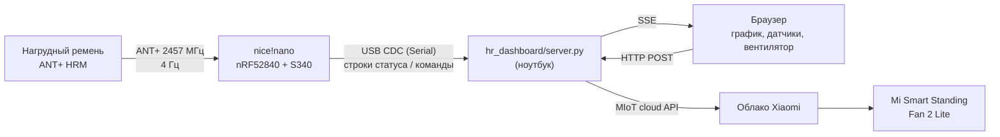

# ANT+ Connector

Приёмник ANT+ пульсометра на **nice!nano (nRF52840)** с живым графиком в браузере и управлением
вентилятором **Xiaomi Mi Smart Standing Fan 2 Lite** по пульсу.

- плата принимает ANT+ Heart Rate Monitor (любой нагрудный ремень ANT+) через стек Garmin/Nordic **S340**;
- видит все ремни поблизости и подключается к выбранному (выбор хранится во флеше платы);
- светодиод на плате мигает в такт пульсу;
- в Serial — пульс, RR-интервал, RSSI, батарея, данные производителя, ~4 раза в секунду;
- веб-страница: график пульса, мин/сред/макс, список датчиков, управление вентилятором;
- вентилятор плавно меняет скорость в зависимости от пульса (через облако Xiaomi).



## Быстрый старт

> Нужны: nice!nano (или другая плата nRF52840 с Adafruit UF2 bootloader), Arduino IDE 2,
> `arm-none-eabi-gcc` (для сборки загрузчика), Python 3.10+.

```bash
git clone --recursive https://github.com/danyarmarkin/ant-plus-connector.git
cd ant-plus-connector

# 1. Скачать ANT SoftDevice S340 с сайта Garmin (бесплатно для некоммерческого использования)
scripts/get_softdevice.sh

# 2. Один раз: заменить на плате SoftDevice S140 -> S340 (загрузчик + стек по USB, без программатора)
#    плата в режиме загрузчика: двойное нажатие reset (появится диск NICENANO)
scripts/flash_bootloader.sh

# 3. Добавить плату "nice!nano (S340 ANT+BLE)" в ядро Adafruit nRF52 (Boards Manager -> Adafruit nRF52)
arduino_s340/install.sh

# 4. Ключ сети ANT+
cp ant_hrm/ant_plus_key.h.example ant_hrm/ant_plus_key.h   # и вписать ключ, см. docs/03-firmware.md
```

5. Открыть `ant_hrm/ant_hrm.ino` в Arduino IDE, выбрать плату **nice!nano (S340 ANT+BLE)**, Upload.
   Serial Monitor 115200 — пульс в консоли.
6. Веб-страница:

   ```bash
   python3 -m venv hr_dashboard/.venv
   hr_dashboard/.venv/bin/pip install -r hr_dashboard/requirements.txt
   hr_dashboard/.venv/bin/python hr_dashboard/server.py      # http://localhost:8765
   ```

7. (опционально) вентилятор: `hr_dashboard/.venv/bin/python xiaomi/login.py` — вход по QR-коду из Mi Home.

## Документация

| | |
|---|---|
| [01 — SoftDevice S340 и загрузчик](docs/01-softdevice-bootloader.md) | что такое S340, где взять, как перепрошить nice!nano без SWD, как откатиться |
| [02 — Плата в Arduino IDE](docs/02-arduino-board.md) | что делает `install.sh`: linker script, вариант, ключ лицензии |
| [03 — Прошивка `ant_hrm`](docs/03-firmware.md) | ANT+ каналы, страницы HRM, формат вывода, команды Serial, светодиод |
| [04 — Веб-страница](docs/04-dashboard.md) | сервер, API, график, выбор датчиков |
| [05 — Вентилятор Xiaomi](docs/05-xiaomi-fan.md) | вход по QR, облачный MIoT API, плавная регулировка, VPN |
| [06 — Проблемы и решения](docs/06-troubleshooting.md) | всё, на что уже наступили |

## Структура

```
ant_hrm/                 скетч Arduino (прошивка платы)
arduino_s340/            плата nice!nano (S340) для ядра Adafruit nRF52: boards.local.txt, .ld, variant, install.sh
hr_dashboard/            сервер (Python, stdlib + pyserial) и страница (HTML/JS без зависимостей)
xiaomi/                  вход в облако Xiaomi, управление вентилятором, обход VPN
xiaomi_extractor/        submodule: PiotrMachowski/Xiaomi-cloud-tokens-extractor (логин Xiaomi)
scripts/                 скачивание S340, сборка и прошивка загрузчика
docs/                    документация
```

## Лицензии и ограничения

- **ANT SoftDevice S340** распространяется только Garmin Canada и не входит в репозиторий.
  Скачивая его, вы принимаете [ANT+ Adopter Agreement](https://developer.garmin.com/ant-program/licensing/adopter-agreement/).
  Встроенный в заголовки **evaluation-ключ** — только для некоммерческого использования; для продукта нужен
  коммерческий ключ ([условия](https://developer.garmin.com/ant-program/nrf5-sdk/)).
- **Ключ сети ANT+** не хранится в репозитории (`ant_hrm/ant_plus_key.h` в `.gitignore`).
- `xiaomi/session.json` содержит токены сессии Xiaomi и тоже в `.gitignore` — не публикуйте его.
- Проект не аффилирован с Garmin, Nordic, Xiaomi или Adafruit.
